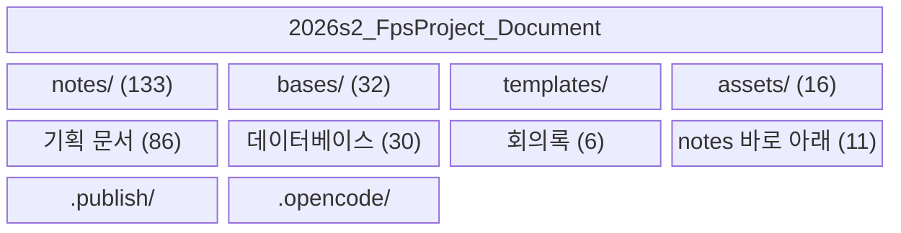

# 팀원

| 인원      | 역할     |
| ------- | ------ |
| [[이현종]] | 팀장, 개발 |
| [[고준협]] | 개발     |
| [[이준호]] | 기획     |
| [[최승운]] | PL     |

# 볼트 구조

문서 분류는 폴더가 아니라 `categories` 링크로 하고, `bases/`가 그 카테고리를 조회한다. 폴더는 노트 타입별 보관 위치다.

# 문서 생성 안내

처음 작업하는 사람인 경우, 아래 링크에 보이는 문서들을 한번씩 읽어주기 바람. 문서 작성 규칙임.

![[문서 생성 안내]]

# 문서 주제별 분류

![[문서 분류]]
