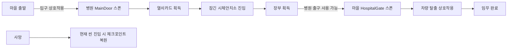

---
aliases:
작성 날짜: 2026-11-06
작성자:
  - "[[인공지능 에이전트]]"
관여 주체:
  - "[[플레이어 캐릭터]]"
  - "[[씬]]"
categories:
  - "[[이현종 게임잼 프로토타입 구현 기록]]"
노트 타입: "[[기획 문서]]"
---

# 상호작용·임무 진행 및 씬 전환 구현 기록

## 한눈에 보기

하나의 상호작용 규약으로 문, 아이템, 씬 출입구와 탈출 목표를 연결한다. 런 중 획득 아이템과 적 처치는 씬 이동 사이에 유지되고, 사망하면 현재 씬에 들어올 때의 상태로 복구된다. 표와 흐름도는 상호작용 종류와 캠페인 경로를 요약한다.

## 구현 개요

월드 상호작용은 `IInteractable` 계약을 구현하는 컴포넌트를 전역 목록에서 찾아 플레이어가 실행하는 방식이다. `PlayerInteractor`는 가까운 대상을 고르고 프롬프트를 갱신하며, 문·아이템·씬 출입구·탈출 차량은 각자의 잠금 조건과 동작을 구현한다. 씬 전환과 런 상태 보존은 정적 `GameProgress`, 씬 초기화는 `SceneFlow`가 맡는다.

| 대상 종류 | 조건 예시 | 상호작용 결과 |
| --- | --- | --- |
| 문 | 필요한 아이템이 있거나 잠금 없음 | 문 회전, 또는 도어 카메라 진입 |
| 아이템 | 플레이어가 접근해 F 입력 | 인벤토리에 아이템 ID 추가 |
| 씬 출입구 | 출구의 아이템 조건 충족 | 대상 씬 로드와 지정 스폰 이동 |
| 탈출 차량 | 장부 아이템 보유 | 임무 완료 화면 |

## 상호작용 대상 선택과 실행

플레이어가 시작할 때 `PlayerInteractor`는 상호작용 프롬프트를 만들고 같은 오브젝트에 `DoorCamera`를 추가한다.^[Assets/Scripts/Player/PlayerInteractor.cs:26-32] 기본 상호작용 거리는 2m이며, 플레이어 위치에서 위로 1m 올린 점과 각 대상의 `InteractionPoint`를 비교한다. 층간 오선택을 막기 위해 높이 차이가 1.5m보다 큰 대상은 제외하고, 남은 대상 가운데 가장 가까운 하나를 현재 대상으로 삼는다.^[PlayerInteractor.cs:13-15; PlayerInteractor.cs:79-99]

F 입력은 Input System `PlayerInput`의 Send Messages를 통해 `OnInteract`에 전달된다. 일시정지, 결과 화면, 사망 상태에서는 처리를 중단하고, 유효한 대상이 선택되어 있으면 해당 `IInteractable.Interact`를 호출한다.^[PlayerInteractor.cs:101-129] 문 앞의 휠 입력은 무기 전환보다 우선해 문 열기와 도어 카메라 중 하나를 선택한다. 문이 열린 상태에서는 도어 카메라 선택을 초기화한다.^[PlayerInteractor.cs:54-77] 프롬프트는 코드로 생성되며 현재 선택된 문 행동을 굵은 글씨와 높은 불투명도로 강조한다.^[Assets/Scripts/UI/InteractionPrompt.cs:45-70]

## 문과 도어 카메라

`Door`는 힌지 위치를 기준으로 한 개 이상의 문짝을 회전시키는 상호작용 대상이다. 열 때 플레이어가 서 있는 쪽을 계산해 문짝이 사용자 반대 방향으로 향하도록 목표 각도를 정하고, 프레임 시간에 따른 지수 보간으로 부드럽게 회전시킨다.^[Assets/Scripts/World/Door.cs:15-25; Assets/Scripts/World/Door.cs:125-169; Assets/Scripts/World/Door.cs:171-179] `requiredItem`이 비어 있으면 누구나 열 수 있고, 아이템 ID가 지정되어 있으면 사용자의 `PlayerInventory`에 그 아이템이 있어야 한다. 적은 코드 주석상 잠금 조건을 무시하고 문을 열 수 있다.^[Door.cs:29-35; Door.cs:99-110; Door.cs:125-129] 문이 완전히 열리면 문짝 메시의 바운즈로 만든 `NavMeshObstacle`을 켜 carve를 적용한다. 이는 문틀을 통한 이동 경로는 유지하면서 열린 문짝이 차지한 공간을 장애물로 처리하기 위한 구성이다.^[Door.cs:39-41; Door.cs:63-83; Door.cs:154-168]

문이 닫혀 있을 때 선택할 수 있는 도어 카메라는 플레이어 몸을 문 너머로 옮기는 대신 별도의 카메라를 문 반대편 낮은 위치에 둔다. `Door.CameraPose`가 카메라의 시작 위치와 시선을 계산하고, `DoorCamera.Open`은 메인 카메라의 설정을 복사한 별도 카메라와 640x360 RenderTexture를 만든 뒤 UI에 영상을 표시한다.^[Door.cs:112-123; Assets/Scripts/Player/DoorCamera.cs:36-93]

도어 카메라를 사용하는 동안에는 무기 발사를 중지하고 상호작용 이외의 입력 액션을 끈 뒤 플레이어 이동과 사격 컴포넌트를 비활성화한다. A/D 입력은 카메라의 이동 가능성을 검사하면서 문틈 방향으로 좌우 이동시키고, 마우스로 제한된 범위 안에서 둘러볼 수 있다. F 입력, 문이 열리는 상황, 사망·일시정지, 문에서 멀어지는 상황에서는 카메라 화면을 정리하고 플레이어 제어를 복구한다.^[DoorCamera.cs:44-54; DoorCamera.cs:95-123; DoorCamera.cs:125-147] 현재 코드에서 확인되는 문 기능은 회전식 열기·닫기와 도어 카메라 정찰이다. 문 발차기는 `Door`와 `PlayerInteractor` 구현에서 확인되지 않는다.

## 아이템과 임무 상태

`PickupItem`은 열쇠카드나 폴더 모양의 간단한 메시를 런타임에 만들고, 발광 재질과 그림자 없는 점광원으로 어두운 장소에서도 찾기 쉽게 한다.^[Assets/Scripts/World/PickupItem.cs:12-26; Assets/Scripts/World/PickupItem.cs:59-88] 플레이어가 F로 주우면 인벤토리에 아이템을 보관하고, 아이템에 소음 반경이 설정된 경우 소음을 발생시킨 뒤 월드 오브젝트를 비활성화한다. 이미 런 상태에 해당 ID가 있으면 씬에 다시 나타나지 않는다.^[PickupItem.cs:31-57]

인벤토리는 아이템별 오브젝트 대신 문자열 ID를 `GameProgress.Items` 집합에 추가한다. 새 ID가 들어올 때 `ItemAdded` 이벤트를 보내 HUD나 미션이 진행 상태를 갱신할 수 있게 한다.^[Assets/Scripts/Player/PlayerInventory.cs:7-19] `Mission`은 순서대로 정의된 단계 배열에서 플레이어가 아직 보유하지 않은 첫 아이템을 찾고 해당 목표 문구를 HUD에 표시한다. 모든 단계 아이템을 모으면 마지막 탈출 목표로 바뀐다.^[Assets/Scripts/World/Mission.cs:13-25; Assets/Scripts/World/Mission.cs:41-58] 최종 상호작용인 차량 탈출은 `MissionGoal`이 evidence 보유 여부를 검사하고, 조건을 만족하면 미션 완료를 호출한다. 완료 시 플레이어 입력은 비활성화된다.^[Mission.cs:60-72; Assets/Scripts/World/MissionGoal.cs:7-31]

## 씬 이동, 스폰, 재시작

`SceneExit`은 도착 씬과 스폰 ID, 상호작용 문구, 통과에 필요한 아이템, 특정 아이템 획득 뒤 닫힐 조건을 가진다. 출입구가 사용 가능한 상태에서 플레이어가 설정 거리 안에 오면 대상 씬의 비동기 로딩을 시작한다. 실제 F 입력이 들어오면 `GameProgress.TravelTo`로 이동을 요청한다.^[Assets/Scripts/World/SceneExit.cs:9-21; Assets/Scripts/World/SceneExit.cs:35-60]

`GameProgress`는 획득 아이템, 사망한 적의 씬별 ID, 한 런 안에서 고정할 랜덤 선택 결과를 정적 컬렉션으로 보관한다. 씬을 옮길 때는 현재 아이템과 적 처치 상태를 체크포인트에 복사하고, 플레이어가 사망해 씬을 재시작하면 체크포인트 시점의 상태로 되돌린다.^[Assets/Scripts/World/GameProgress.cs:14-30; Assets/Scripts/World/GameProgress.cs:70-85; Assets/Scripts/World/GameProgress.cs:104-116; Assets/Scripts/World/GameProgress.cs:145-151] 씬 로딩은 백그라운드 사전 로딩으로 전환 대기 시간을 줄인다. 미리 읽고 있던 씬이 목적지와 다르면 로딩을 완료시킨 뒤 요청한 씬으로 다시 이동한다. 전환 직전에는 `ScreenFade.Cover`로 화면을 가리고, 새 씬이 시작된 뒤 `SceneFlow`가 페이드와 사운드 프리로드를 처리한다.^[GameProgress.cs:53-68; GameProgress.cs:118-143; Assets/Scripts/World/SceneFlow.cs:38-45]

각 씬의 `SceneFlow`는 `SpawnPoint`를 검색해 `PendingSpawn` ID와 일치하는 지점을 선택하고, 일치하는 점이 없으면 기본 스폰을 사용한다. 위치를 옮기는 동안 `CharacterController`를 잠시 끈다. 이전 방문에서 이미 죽은 적은 첫 프레임 실행 전에 비활성화하고 제거하며, 살아 있는 적의 사망 이벤트는 런 상태에 기록한다.^[SceneFlow.cs:17-35; SceneFlow.cs:47-64] 새 런을 시작하거나 타이틀로 돌아가면 아이템·처치·랜덤 선택 상태를 초기화한다.^[GameProgress.cs:44-51; GameProgress.cs:87-102]

## 실제 캠페인 연결

마을의 병원 입구는 병원 씬의 MainDoor 스폰을 지정한다. 플레이어가 장부를 확보해 evidence를 보유하면 해당 입구는 다시 사용할 수 없게 닫힌다. 병원 출구는 evidence를 얻기 전에는 잠겨 있고, 조건을 만족한 뒤에는 야외 씬의 HospitalGate 스폰으로 돌아간다. 마지막으로 마을에 놓인 차량의 `MissionGoal`이 같은 증거 아이템을 확인해 탈출을 완료한다.^[Assets/Scripts/Editor/VillageLevelBuilder.cs:78-110; Assets/Scripts/Editor/AsylumEnemyPlacer.cs:238-287]

이 진행 상태는 실행 중인 프로세스의 정적 메모리에 보관된다. 저장 파일을 생성하거나 게임을 종료한 뒤 이전 런을 복구하는 영속 세이브 시스템은 이 코드에서 확인되지 않는다.
