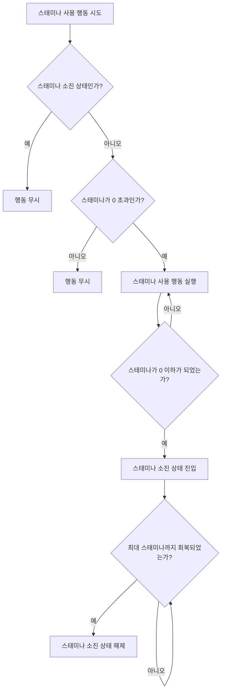

---
aliases:
작성 날짜: 2026-09-28T17:27
작성자:
  - "[[이준호]]"
관여 주체:
  - "[[플레이어 캐릭터]]"
categories:
  - "[[용어]]"
  - "[[플레이어 스테이터스(초기 기획)]]"
노트 타입: "[[기획 문서]]"
---
# 스태미나 스테이터스의 종류

| **항목** | **값** | **비고** |
| --- | --- | --- |
| 최대 스태미나 | 100 | 초기 고정값 |
| 현재 스태미나 | 0 ~ 최대 스태미나 | 지속적으로 소모되는 스태미나 양. 실제 남은 스태미나의 양을 추적하기 위한 값임 |
| 스태미나 회복 지연 시간 | 2s | 스태미나 소모가 멈추면 2초 뒤 회복 시작 |
| 스태미나 회복 속도 | 12.5/s | 스태미나 회복 시 초당 회복되는 양 |
| 전력 질주 스태미나 소모량 | 6.67/s | 스태미나 초당 소모량 |
| 점프 스태미나 소모량 | 20/회 | 한 번 점프할 때마다 소모되는 스태미나 양 |

현재 스태미나가 0 이하가 되면 [[플레이어 캐릭터]]는 스태미나 소진 상태에 빠진다.

# 스태미나 사용 절차

## 스태미나 소진 상태

스태미나가 0이 되면 즉시 스태미나 소진 상태가 된다. 이 상태에 들어서면 스태미나가 최대 스태미나까지 100% 회복될 때까지 스태미나를 사용할 수 없다.

스태미나 소진 상태는 최대 스태미나까지 회복되면 바로 사라진다.

## 전력 질주

`Shift`를 누른 상태에서 이동하면, 플레이어는 그냥 걷지 않고 가능한 한 빠른 속도로 달려간다. 전력 질주를 하는 동안에는 스태미나를 소모하게 되지만, 대신 그 대가로 더 빠른 속도로 이동할 수 있다. 주로 적이 사격하는 상황에서 멀리 떨어진 엄폐물로 달려가기 위해 사용된다. 스태미나가 없거나, 스태미나 소진 상태라면 `Shift`를 눌러도 전력 질주를 할 수 없다.^[[[플레이어 스테이터스]] 문서 참조]
