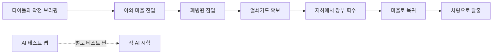
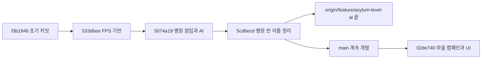

---
aliases:
작성 날짜: 2026-11-06
작성자:
  - "[[인공지능 에이전트]]"
관여 주체:
  - "[[플레이어 캐릭터]]"
  - "[[적]]"
  - "[[씬]]"
categories:
  - "[[이현종 게임잼 프로토타입 구현 기록]]"
노트 타입: "[[기획 문서]]"
---

# 이현종 게임잼 프로토타입 구현 개요 및 브랜치 이력

## 한눈에 보기

초기 FPS 전투 실험은 병원 잠입 프로토타입으로 확장되었고, `main`에서 마을 접근과 탈출을 포함한 캠페인으로 이어졌다. 아래 흐름도는 플레이 순서를, 브랜치 그림은 커밋의 계보를 요약한다. 기능별 구현은 이 데이터베이스의 나머지 기록에서 다룬다.

## 확인 기준

`/Users/junho/Repositories/Game_Jam_dlguswhd` 저장소의 로컬 `main`, 원격 추적 `origin/main`, `origin/feature/asylum-level-ai`와 이 브랜치들이 가리키는 커밋 이력을 확인했다. 확인한 시점에 로컬 작업 트리는 깨끗했다. `origin/feature/asylum-level-ai`의 끝 커밋 `5cd6ecd`는 `main`의 조상이며, 두 브랜치가 별도로 갈라져 서로 다른 기능을 유지하는 형태는 아니다.

아래 내용은 저장소에 커밋된 C# 스크립트, 씬·프리팹·에디터 도구와 문서를 바탕으로 정리했다. Unity 에디터에서 실제 플레이하거나 빌드 테스트한 결과는 아니다. KINEMATION 및 캐릭터·병원 에셋 일부는 저장소 밖에서 별도로 가져와야 하므로 이 문서만으로 완전한 재현을 보장하지 않는다.

## 프로젝트 구성

프로젝트는 Unity `6000.3.27f1`과 URP를 사용한다.^[ProjectSettings/ProjectVersion.txt] 빌드 설정에는 타이틀 `Assets/Scenes/Title.unity`, 야외 마을 `Assets/Scenes/Bridge_Village.unity`, 병원 `Assets/Scenes/Abandoned_Hospital.unity`, AI 테스트 `Assets/Scenes/Test_map.unity` 순으로 씬이 등록되어 있다.^[ProjectSettings/EditorBuildSettings.asset:7-19] 플레이어는 타이틀의 작전 브리핑에서 출발해 마을을 지나 병원에 잠입하고, 열쇠카드와 장부를 확보한 뒤 야외로 돌아와 차량으로 탈출한다. 테스트 맵은 이 캠페인 흐름과 별개로 적 AI를 시험하기 위한 씬이다.

공통 런타임 로직은 `Assets/Scripts` 아래 전투, 적, 플레이어, UI, 월드 시스템으로 나뉜다. KINEMATION이 제공하는 플레이어·무기 동작을 게임 코드가 연결하고, 잠입에 필요한 이동·피해·소음·임무 흐름을 추가하는 구조다.

## 브랜치와 커밋별 발전

초기 커밋 `533dbee`는 FPS 프로토타입의 기반을 만들었다. 플레이어 이동과 총격, 적 AI, 테스트 씬을 추가하고 체력·피격 판정과 에디터용 적 설정·맵 생성 코드를 마련했다. 이어진 `5074a19`에서는 병원 씬과 잠입 플레이가 중심이 되었다. 적 인식은 순찰·경계·전투로 확장되었고, 소음 전달과 문 상호작용, 열쇠카드·아이템, 임무 HUD, 레이저 조준 장치가 추가되었다. `5cd6ecd`에서는 병원 씬을 `Abandoned_Hospital`로 추적하고 테스트 씬을 `Test_map`으로 이름 정리했으며, 빌드 설정과 에디터 도구 참조도 새 이름에 맞췄다.

`origin/feature/asylum-level-ai`는 병원·AI 기능을 포함한 이력의 끝인 `5cd6ecd`를 가리킨다. 이 브랜치의 프로토타입은 병원 내부에서 열쇠카드를 찾아 잠긴 지하 시체안치소에 들어가 장부를 회수한 뒤 정문으로 탈출하는 단일 레벨 잠입 구조다. 레벨의 의도와 적 배치는 `레벨디자인.md`, 생성 코드는 에디터 도구에서 확인할 수 있다.^[Assets/Scripts/Editor/AsylumEnemyPlacer.cs:53-128; Assets/Scripts/Editor/AsylumEnemyPlacer.cs:130-288]

현재 `main`의 커밋 `02de740`은 해당 기능 브랜치의 후손이다. 병원 시스템을 대체하지 않고 그 앞뒤에 야외 마을 레벨과 캠페인 흐름을 덧붙였다. `Bridge_Village` 씬과 터레인·환경 머티리얼·NavMesh, 차량 자산을 추가하고, `Title` 씬에 브리핑·설정·조작 설명을 마련했다. 마을과 병원 사이를 오가는 출입구 및 스폰 지점, 씬 이동 중 보존되는 아이템·적 처치 상태, 사전 로딩도 이 단계에서 연결됐다. 닫힌 문 너머를 보는 도어 카메라와 총탄 관통·탄흔 기능은 병원 씬 및 적 프리팹 변경과 함께 추가되었다. 마을의 플레이어·임무·적·NavMesh 구성은 에디터 빌더가 생성한다.^[Assets/Scripts/Editor/VillageLevelBuilder.cs:59-120]

위 그래프에서 `origin/feature/asylum-level-ai`는 `5cd6ecd` 지점을 가리키며, 현재 `main`은 그 지점에서 마을 캠페인을 더한 후속 커밋이다.

## 외부 에셋 및 재현 조건

저장소의 `README.md`는 KINEMATION Tactical Shooter Pack, Abandoned Asylum, Gang members 캐릭터 팩을 별도로 가져와야 한다고 안내한다. `진행상황.md`에는 KINEMATION 원본에 적용한 수정 사항도 저장소에 포함되지 않는다고 적혀 있다. Flooded Grounds와 차량 모델은 저장소에 포함되지만 일부 대용량 자산은 Git LFS로 관리된다. 따라서 씬의 직렬화 데이터만 보고 참조 에셋 전체가 저장소에 있다고 판단해서는 안 된다. 이 문서의 설명은 커밋된 코드와 자료를 바탕으로 한 정적 분석이며 Unity 실행 검증은 포함하지 않는다.

플레이어 전투와 탄환 처리는 [[플레이어 이동·전투 및 탄환 구현 기록]]에서, 적 AI와 소음 전달은 [[적 AI·소음 및 병원 잠입 구현 기록]]에서 자세히 다룬다. 상호작용과 캠페인 진행은 [[상호작용·임무 진행 및 씬 전환 구현 기록]]에, 화면 구성과 에디터 레벨 제작 도구는 [[타이틀·게임 UI 및 레벨 제작 도구 구현 기록]]에 정리했다.
