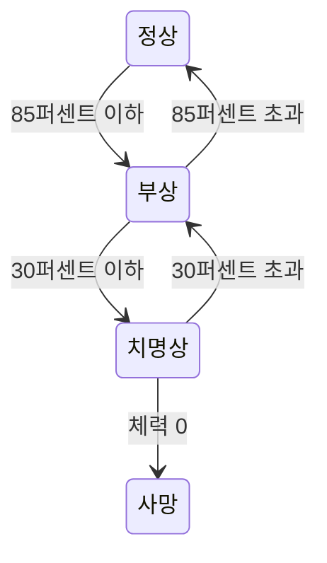
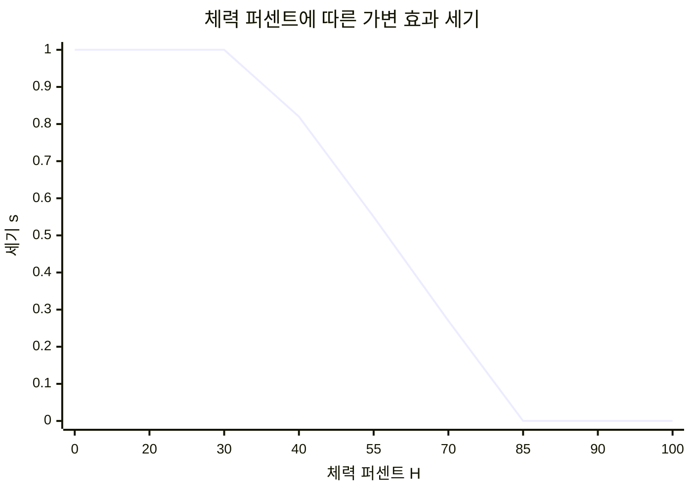
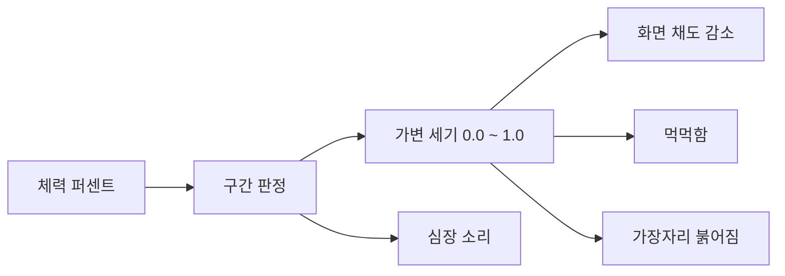

---
aliases:
작성 날짜: 2026-11-13T22:06:00
작성자:
  - "[[이준호]]"
관여 주체:
categories:
  - "[[UI 기획]]"
노트 타입: "[[기획 문서]]"
---

# 체력 묘사 방식

## 기획 목적

이 게임은 플레이어의 체력을 체력바로 보여주지 않는다. 전략적인 판단이 중심인 게임에서 숫자 하나로 줄어드는 체력은 교전의 긴장을 지나치게 단순하게 만든다. 체력이 화면 한쪽에 상시 표시되면 플레이어는 남은 체력을 계산하며 싸우게 되고, 그 순간 교전은 자원 관리로 바뀐다.

대신 체력은 청각과 시각으로 전달한다. 플레이어는 남은 체력을 정확히 알지 못한 채 자신이 얼마나 다쳤는지를 감각으로 판단한다. 이 게임에서 체력은 숫자가 아니라 상태다. 체력이 낮아졌다는 사실을 화면과 소리가 먼저 알리고, 플레이어는 그 신호를 읽어 물러설지 밀어붙일지 결정한다.

## 체력 구간

체력은 최대 체력 대비 퍼센트로 네 구간을 나눈다. 구간마다 플레이어가 받아야 할 인상이 다르고 활성화되는 효과도 다르다.

부상 상태의 효과는 구간 안에서 강도가 연속해서 변한다. 체력이 더 심각한 구간으로 내려가면 그 효과는 최대 강도로 유지되고, 상위 구간의 효과가 추가로 적용된다. 예를 들어 체력이 20퍼센트라면 부상 상태의 효과가 모두 최대 강도로 적용되고, 여기에 치명상 상태의 심장 소리가 더해진다.

심장 소리는 가변 효과가 아니다. 치명상 구간에서만 재생되는 이진 효과이며, 구간에 들어오면 재생하고 구간을 벗어나면 정지한다.

| 상태     | 묘사 목적                                      |
| ------ | ------------------------------------------ |
| 사망 상태  | 플레이어가 사망했고, 더 이상 플레이 불가능한 상태라는 것을 보여주기 위함. |
| 치명상 상태 | 플레이어의 체력이 총알 몇 발만 맞아도 죽을 수 있을 정도라고 알려주는 것  |
| 부상 상태  | 플레이어가 부상을 입었는데, 작은 부상인지, 큰 부상인지 알려주는 것     |
| 정상 상태  | 체력이 싸우는 데 신경 쓰이지 않는 수준임을 알리는 것             |

- `H`: 최대 체력 대비 체력 퍼센트
- `state(H)`: 해당 체력에서의 상태

$$ \text{state}(H) = \begin{cases} \text{사망} & 0 \\ \text{치명상} & 0 < H \le 30 \\ \text{부상} & 30 < H \le 85 \\ \text{정상} & 85 < H \le 100 \end{cases} $$

구간 비율은 임시값이며, 각 효과의 강도도 임시값이다. 플레이테스트를 거쳐 조정해야 하며, 이에 따라 구현할 때에도 변동이 쉽도록 조절해야 한다.

## 가변 효과와 이진 효과

### 가변 효과의 규칙

가변 효과는 구간의 최댓값에서 최솟값으로 갈수록 세기가 연속해서 변한다. 여기서 세기는 효과의 강도를 뜻하며, 0은 효과 없음, 1은 최대다. 세기를 계산할 때 쓰는 값은 다음과 같다.

- `H`: 체력 퍼센트
- `s(H)`: 해당 체력에서의 효과 세기
- `H_high`: 부상 구간의 시작, 85
- `H_low`: 부상 구간의 끝, 30

$$ s(H) = \mathrm{clamp}\left(\frac{H_{high} - H}{H_{high} - H_{low}},\ 0,\ 1\right) $$

이 식 하나가 세 가지 동작을 모두 담는다. 계산 결과는 0과 1 사이로 잘린다. `H_high`에서 0, `H_low`에서 1이 되고, `H_low` 아래에서는 1로 고정되며, `H_high` 위에서는 0으로 고정된다. 체력이 줄어들수록 세기가 강해지고, 회복하면 같은 비율로 되돌아간다. 경계를 조정할 때는 두 변수만 바꾸면 된다.

**가변 효과 파라미터 초기값**

| 효과 | 조절 값 | 85퍼센트에서 | 30퍼센트에서 | 30퍼센트 이하 |
| --- | --- | --- | --- | --- |
| 화면 채도 감소 | `saturationReduction` | 0, 원색 | -100, 완전 흑백 | -100 유지 |
| 먹먹함, 음량 | `volumeReduction` | 감소 없음 | 최대 감소 | 최대 유지 |
| 먹먹함, 음역 | `lowpassCutoff` | 20000Hz | 1000Hz | 1000Hz 유지 |
| 가장자리 붉어짐 | `vignetteIntensity` | 0, 없음 | 최대 | 최대 유지 |

세 효과는 모두 부상 구간에서만 변하고, 치명상 구간에서는 최대 세기를 유지한다.

체력이 변하면 목표 세기 `s(H)`가 즉시 다시 계산되지만, 화면과 소리에 실제로 적용되는 세기는 그 값을 곧바로 따라가지 않는다. 차이가 클 때는 빠르게, 작을 때는 느리게 접근하며, 짧게는 0.1초, 길게는 0.5초 사이에서 자연스럽게 도달한다. 구체적인 계산은 전이와 예외 절에 적는다.

모든 가변 효과는 같은 목표 세기 `s(H)`를 공유하므로, 같은 전환 시간을 쓰면 항상 같은 비율로 함께 변한다.

### 이진 효과의 규칙

이진 효과는 강도가 아니라 재생 여부만 관리하는 효과다. 체력 값에 따라 세기가 연속으로 변하는 가변 효과와 달리, 이진 효과는 정해진 상태에 들어가면 켜지고 상태를 벗어나면 꺼진다. 세기는 항상 0 또는 1이며 그 사이 값이 없다. 현재 기획된 이진 효과는 치명상 상태의 심장 소리 하나다.

가변 효과와 이진 효과의 차이는 입력에 있다. 가변 효과는 체력 퍼센트 `H`를 받아 세기를 계산하고, 이진 효과는 `state(H)`가 해당 상태인지만 확인한다.

| 구분 | 입력 | 출력 | 전환 |
| --- | --- | --- | --- |
| 가변 효과 | 체력 퍼센트 `H` | 세기 0.0에서 1.0, 연속 | `τ`로 서서히 접근 |
| 이진 효과 | 상태 `state(H)` | 켜짐 또는 꺼짐, 이산 | 즉시 |

이진 효과에는 다음 규칙을 적용한다.

- 세기 파라미터를 두지 않는다. 인스펙터에 강도 조절 값을 노출하지 않는다.
- 전환 시간 `τ`를 적용하지 않는다. 상태가 바뀐 프레임에서 즉시 재생하거나 정지하며, 페이드 인과 아웃을 두지 않는다.
- 상태 전이가 확정된 뒤에 판정한다. 상태가 바뀌는 프레임에서 재생 여부를 함께 갱신한다.
- 사망이 확정되면 재생 중인 이진 효과를 모두 정지하며, 사망 상태에서는 다시 켜지 않는다.
- 리스폰 시에는 비활성 상태로 초기화한다.
- 가변 효과의 세기와 독립적이다. 부상 상태 효과가 최대 세기여도 이진 효과의 재생 여부에는 영향을 주지 않는다.

| 이진 효과 | 활성 조건 | 해제 조건 | 비고 |
| --- | --- | --- | --- |
| 심장 소리 | 치명상 상태 진입 | 치명상 상태 이탈, 사망 | 저역통과 필터에서 제외 |

새 효과를 분류할 때는 두 가지만 확인한다. 체력 퍼센트에 따라 세기를 조절해야 하면 가변 효과이고, 켜고 끄는 것으로 충분하면 이진 효과다. 켜짐과 꺼짐 사이에 연출이 필요하다면 그 효과는 가변 효과로 다루고 전환 시간을 정한다.

## 전이와 예외

상태는 경계를 넘는 순간 바뀐다. 들어가는 기준과 나가는 기준을 따로 두지 않으므로, 30퍼센트와 85퍼센트를 넘으면 즉시 전이한다.

상태 전환에 별도의 여유 기준을 두지 않는다. 경계값은 구간식과 같다.

체력이 바뀔 때마다 목표 세기를 다시 계산하고, 실제 세기는 그 목표로 부드럽게 접근한다. 한 번에 이동하지 않고 차이가 클 때는 빠르게, 작을 때는 느리게 움직인다.

- `s_t`: 이번 프레임의 세기
- `s_(t-1)`: 직전 프레임의 세기
- `s_target`: 목표 세기
- `Δt`: 프레임 경과 시간
- `τ`: 전환 시간

$$ s_t = s_{\text{target}} + (s_{t-1} - s_{\text{target}}) \cdot e^{-\Delta t / \tau} $$

$\tau$는 전환 시간이다. 값을 키우면 반응이 느려지고 줄이면 즉시에 가까워진다. 이렇게 하면 화면과 소리가 튀지 않고, 상태 경계를 넘을 때도 강도가 이어진다. 전환 시간은 가변 효과 세 가지가 공유하는 값 하나다.

회복은 진입과 같은 속도로 역방향 진행한다. 체력이 0이 되면 사망하며, 그 순간 모든 효과를 정지하고 사망 전용 효과로 전환한다. 리스폰 시에는 정상 상태와 가변 세기 0으로 초기화한다.

## 판정 시점과 사망 처리

체력 변화는 매 프레임 검사하지 않고, 체력이 바뀌는 시점에 판정한다. 체력을 직접 수정하지 않고 피해와 회복 함수를 통해서만 바꾸며, 그 함수 안에서 사망과 상태 전이를 즉시 확정한다. 한 프레임 안에서 피해와 회복이 연달아 들어와도 중간 상태를 건너뛰지 않는다.

매 프레임 하는 일은 목표 세기를 현재 체력에서 다시 계산하고, 실제 세기를 그 목표에 가깝게 만드는 것뿐이다. 목표 세기는 즉시 바뀌지만 실제 세기는 위에서 정한 전환 시간에 따라 부드럽게 따라간다.

- 초과 피해량은 기록한다. 체력은 0에서 멈추지만, 0을 넘겨 들어온 피해량을 남겨 사망 연출과 통계에 쓴다.
- 사망을 확정하면 이후 피해, 회복, 상태 전이를 모두 막는다. 리스폰만 초기화 경로로 둔다.
- 다중 피해는 합산하지 않고 각각 처리한다. 첫 치명타에서 사망하므로 어느 피해가 마지막이었는지 남는다.
- 판정 순서는 피해 적용, 사망 판정, 상태 전이, 연출 갱신으로 고정한다.

## 사망 피드백

체력바가 없으므로 사망 순간의 정보가 더 중요하다. 마지막 피해의 방향을 짧게 표시하고, 사망 직전 짧은 화면 정지로 인과를 체감시킨다. 사망 화면에는 마지막 타격의 방향과 거리를 남긴다. 치명상 구간의 심장 소리와 채도 감소는 위험을 예고하고, 이 피드백은 무엇에 맞았는지를 채운다.

## 상태별 효과

가변 효과는 상태가 아니라 체력 퍼센트에 따라 세기가 연속으로 변한다. 그래서 상태별로 값을 적는 표로는 표현할 수 없다. 세 효과는 하나의 세기 축을 공유하며, 85퍼센트 위와 30퍼센트 아래에서만 값이 고정된다.

세기가 클수록 연출이 강해진다. 체력이 줄어드는 내내 값이 연속해서 오르고, 구간에 들어서는 순간 켜지는 방식이 아니다. 각 효과가 이 세기를 어떻게 쓰는지는 다음과 같다.

- 화면 채도 감소: `-100 * s`, 세기 1에서 완전 흑백
- 먹먹함 음량: `s`에 비례해 감소
- 먹먹함 저역 컷오프: `s`에 대해 기하 보간, 20000Hz에서 1000Hz
- 가장자리 붉어짐: `s`에 비례해 강도 증가

이진 효과는 세기가 아니라 재생 여부만 가지므로 상태 단위로 적는 편이 맞다.

- 심장 소리: 치명상 진입 시 재생, 이탈 또는 사망 시 정지. 세기 조절과 전환 시간을 두지 않는다.

사망 전용 효과는 아직 정해지지 않았다. 사망 상태의 처리는 아래에서 다룬다.

### 사망 상태

체력이 0이 되면 진입한다. 진입하는 순간 채도 감소, 먹먹함, 가장자리 붉어짐, 심장 소리를 모두 정지한다. 이후 사망 전용 효과로 전환하며, 그 내용은 아직 정해지지 않았다. 사망 상태에서는 다른 효과가 다시 켜지지 않는다.

### 치명상 상태

#### 심장 소리

느린 심장박동이 들린다. 주변 소리가 멀어지고 먹먹해지는 가운데 자기 심장소리만 또렷하게 남는다. 이 대비가 지금 위험하다는 사실을 설명 없이 전달한다.

구현할 때는 심장소리를 저역통과 필터에서 제외한다. 심장소리까지 먹먹해지면 가장 중요한 신호가 사라진다.

치명상 구간에 들어오면 재생을 시작하고, 구간을 벗어나면 정지한다. 세기를 서서히 바꾸지 않으므로 페이드 인과 아웃을 두지 않는다. 박동 속도도 체력에 따라 바꾸지 않으며, 재생 여부만 관리한다.

에셋은 [이 Royalty Free 심장 박동소리 사운드](https://pixabay.com/sound-effects/film-special-effects-thudding-heartbeat-372487/)를 사용할 예정이다.

### 부상 상태

#### 화면 채도 감소

85퍼센트에서는 채도 감소가 0이므로 화면이 원래 색을 유지한다. 체력이 낮아질수록 채도가 서서히 빠지고, 30퍼센트에서 완전 흑백이 되어 치명상 구간까지 유지된다. 구간에 들어서는 순간 흑백이 되는 것이 아니라, 구간을 지나는 동안 연속해서 변한다. 피가 빠져나가는 감각을 색의 소실로 옮긴 것이다.

- `H`: 체력 퍼센트
- `s(H)`: 효과 세기
- `saturation(H)`: 화면 채도 감소량(0은 원색, -100은 완전 흑백)

$$ \text{saturation}(H) = -100 \cdot s(H) $$

이 식에 따라 채도 감소량은 85퍼센트에서 0, 30퍼센트에서 -100이 된다.

#### 먹먹함

주변 소리가 작아지고 고음역이 깎여 둔탁하게 들린다. 총성의 방향과 거리를 판단하기 어려워지는데, 이는 의도된 불리함이다. 음량과 고역 감쇠량은 인스펙터에서 각각 조절할 수 있어야 한다.

- `s`: 효과 세기
- `f_c(s)`: 저역 컷오프 주파수
- `f_max`, `f_min`: 최대와 최소 컷오프 주파수

$$ f_c(s) = f_{\max} \cdot \left(\frac{f_{\min}}{f_{\max}}\right)^{s} $$

주파수는 로그 감각으로 들리므로 선형이 아니라 기하 보간을 쓴다. 20000Hz에서 1000Hz까지 내려가며, 중간 지점에서도 먹먹함이 자연스럽게 이어진다.

고음역을 깎았을 때 소리가 어떻게 먹먹해지는지는 [예시 영상](https://www.youtube.com/watch?v=YRItyB6GgIo)에서 확인할 수 있다.

#### 가장자리 붉어짐

시야 가장자리가 붉어진다. 피를 흘리고 있다는 사실을 강조하기 위한 연출이며, 화면 전체가 아니라 가장자리만 물들인다. 구현은 UI 오버레이를 우선 검토한다. 채도 감소 이후 단계에서 그려야 붉은색이 살아남기 때문이다. 참고 에셋은 [Screen Damage](https://assetstore.unity.com/packages/tools/particles-effects/screen-damage-160269)이며, 에셋이 붉어짐 범위를 어디까지 조절할 수 있는지는 확인이 필요하다.

### 정상 상태

적용되는 효과가 없다. 우리가 종이에 손을 베인 정도는 그냥 아무 문제 없이 놔두고 일상생활하는 것처럼, 작은 수준의 부상은 교전 중에 플레이어가 신경쓰지 않도록 한다. 효과가 없다는 사실 자체가 체력이 최대치에 가깝다는 추상적인 정보를 준다. 이 구간에는 효과를 추가하지 않는다.

## 구현 흐름

체력 퍼센트가 구간 판정을 거쳐 세기로 변환되고, 그 세기가 각 효과로 전달된다.

효과 세기는 하드코딩하지 않는다. 음량 감소량, 고역 감쇠량, 채도 감소량, 가장자리 크기는 인스펙터에서 조절할 수 있어야 한다.

사망이 확정되면 이 흐름을 멈추고 사망 전용 효과만 남긴다. 가변 세기도 갱신하지 않는다.

## 미정 사항

| 항목 | 예시값 | 조정 범위 | 결정 시점 |
| --- | --- | --- | --- |
| 구간 경계 | 30, 85 | 플레이테스트로 조정 | 프로토타입 |
| 가변 효과 전환 시간 | 0.3초 | 0.1초에서 0.5초, 세 효과 공통 | 프로토타입 |
| 저역 컷오프 | 20000Hz에서 1000Hz | 고음 감쇠 정도에 따름 | 프로토타입 |
| 흑백 채도 | 0(원색)에서 -100(흑백) | 효과 강도에 따름 | 프로토타입 |
| 인스펙터 노출 범위 | 미정 | 각 값의 최소와 최대 | 프로토타입 |
| 심장 소리 박동 속도 | 고정 | 체력 연동 여부 검토 | 프로토타입 |
| 사망 전용 효과 | 미정 | 연출 방식과 길이 | 사망 연출 기획 시 |

> [!question] 확인이 필요한 항목
> 참고 에셋이 붉어짐 범위 조절을 지원하는지 확인해야 한다. 지원하지 않으면 UI 오버레이로 직접 구현한다.
