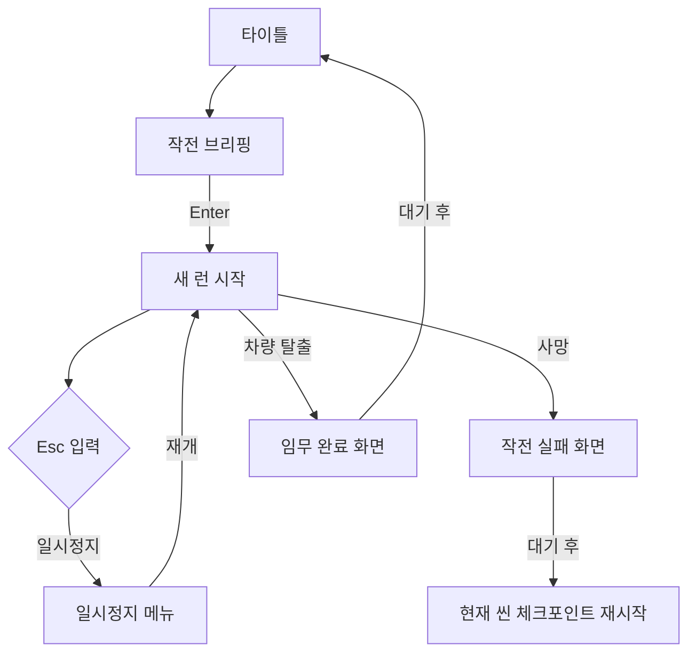

---
aliases:
작성 날짜: 2026-11-06
작성자:
  - "[[인공지능 에이전트]]"
관여 주체:
  - "[[플레이어 캐릭터]]"
  - "[[씬]]"
categories:
  - "[[이현종 게임잼 프로토타입 구현 기록]]"
노트 타입: "[[기획 문서]]"
---

# 타이틀·게임 UI 및 레벨 제작 도구 구현 기록

## 한눈에 보기

타이틀부터 결과 화면까지의 UI는 대부분 코드에서 생성하며, 병원과 마을의 적·출구·목표는 Unity 에디터 빌더가 씬에 배치한다. 아래 흐름도와 표는 플레이 화면이 이어지는 방식과 화면별 책임을 요약한다. 레벨 빌더는 플레이 런타임 기능이 아니라 편집 단계의 제작 도구다.

## 구현 개요

타이틀 화면, 설정, 상호작용 안내, 미션 HUD, 일시정지·결과 화면은 주로 Unity UI 오브젝트를 코드에서 생성한다. 플레이 레벨의 임무·적·스폰·출구 설정은 Unity 에디터 전용 빌더가 씬에 배치한다. 따라서 화면과 레벨 기능은 씬 파일뿐 아니라 `Assets/Scripts/UI`와 `Assets/Scripts/Editor`의 코드에 의해 구성된다.

## 타이틀과 브리핑

`TitleScreen`은 씬 진입 시 시간 배율과 커서를 기본 상태로 맞춘 뒤 `UIKit`을 사용해 타이틀 `Canvas`와 배경, 메뉴, 설정, 조작법, 브리핑 패널을 만든다. 각 화면은 별도 씬을 여는 대신 같은 UI 루트 안에서 해당 패널의 활성 상태를 바꾸어 표시한다.^[Assets/Scripts/UI/TitleScreen.cs:33-56; Assets/Scripts/UI/TitleScreen.cs:103-109] 메뉴에는 작전 시작, 설정, 조작법, 종료 항목이 있다. 작전 시작은 브리핑을 보여주며, 브리핑 중 Enter 또는 숫자 키패드 Enter를 누르면 `GameProgress.StartRun`을 한 번 호출해 새 런으로 넘어간다.^[TitleScreen.cs:58-73; TitleScreen.cs:138-148] 타이틀과 브리핑의 글자·버튼·패널은 코드에서 만들고, 제목 글자 크기는 화면 폭에 맞춰 조정한다.^[TitleScreen.cs:75-87; TitleScreen.cs:111-176]

| 화면 | 호출·생성 주체 | 주요 역할 |
| --- | --- | --- |
| 타이틀·브리핑 | 타이틀 씬의 시작 컴포넌트 | 새 런 시작, 조작 안내, 설정 진입 |
| 상호작용 안내 | 플레이어 상호작용 컴포넌트 | 주변 대상과 문 행동 표시 |
| 목표 HUD | 씬의 임무 컴포넌트 | 아이템 획득에 따른 현재 목표 표시 |
| 일시정지 | 씬 흐름 초기화 컴포넌트 | 시간·오디오 정지, 재개, 설정 |
| 결과 화면 | 사망 또는 임무 완료 처리 | 사망 후 재시작 또는 성공 후 타이틀 복귀 |

## UI 생성 방식과 표시

`UIKit`은 `Canvas`, `RectTransform`, 레이블, 버튼과 레이아웃처럼 반복되는 UI 생성을 돕는 공통 헬퍼다. 화면별 컴포넌트는 이를 이용해 런타임 오브젝트를 만들기 때문에 여러 UI가 별도의 프리팹·폰트 리소스 없이 동작하도록 구성되어 있다. 예를 들어 상호작용 프롬프트는 운영체제 폰트 후보를 사용하고 둥근 배경 스프라이트도 픽셀 텍스처로 생성한다.^[Assets/Scripts/UI/InteractionPrompt.cs:29-43; Assets/Scripts/UI/InteractionPrompt.cs:80-100; Assets/Scripts/UI/InteractionPrompt.cs:161-190] 프롬프트는 화면 중앙 아래에 상호작용 대상을 안내하며, 문 앞에서는 열기와 도어 카메라 선택지를 함께 보여주고 현재 선택된 행동을 강조한다.^[InteractionPrompt.cs:45-70]

`MissionHUD`는 현재 목표를 화면 좌측 상단에 표시하고 별도의 중앙 배너를 제공한다. 목표 내용은 `Mission`이 아이템 획득에 맞춰 갱신한다.^[Assets/Scripts/UI/MissionHUD.cs:14-36; Assets/Scripts/World/Mission.cs:28-58] 플레이 중 Esc를 누르면 `SceneFlow`가 생성해 둔 `PauseMenu`가 시간과 오디오를 멈추고 플레이어 입력을 비활성화한다. 재개 시 입력과 게임 진행을 되돌리며, 사망·완료 화면이 표시된 상태에서는 새로 일시정지하지 않는다.^[Assets/Scripts/UI/PauseMenu.cs:20-45; Assets/Scripts/UI/PauseMenu.cs:55-97]

사망과 임무 성공은 `EndScreen`의 공통 결과 화면을 사용한다. 화면은 실시간 기준으로 검은 배경을 페이드하고 결과 문구를 보여준 뒤 콜백을 실행한다. 사망 결과에는 체크포인트 재시작, 성공 결과에는 타이틀 복귀가 연결된다.^[Assets/Scripts/UI/EndScreen.cs:18-32; Assets/Scripts/UI/EndScreen.cs:55-78] 씬 전환용 `ScreenFade`는 `DontDestroyOnLoad` 오브젝트로 유지되어 로딩 직전 화면을 검게 덮고, 새 씬이 시작된 뒤 0.5초에 걸쳐 다시 드러낸다.^[Assets/Scripts/UI/ScreenFade.cs:6-23; Assets/Scripts/UI/ScreenFade.cs:25-47; Assets/Scripts/UI/ScreenFade.cs:58-63]

## 설정 저장

타이틀과 일시정지 화면에서 공유하는 설정 패널은 마우스 감도와 전체 음량 슬라이더를 제공한다.^[Assets/Scripts/UI/SettingsPanel.cs:7-33] 실제 설정값은 `GameSettings`가 `PlayerPrefs`를 통해 관리한다. 마우스 감도는 0.2에서 3 사이, 전체 음량은 0에서 1 사이로 제한하며 음량은 `AudioListener.volume`에도 즉시 반영한다. 씬이 로드되기 전에 저장된 값을 읽어 적용하고, 설정 패널에서 돌아갈 때 명시적으로 저장을 요청한다.^[Assets/Scripts/World/GameSettings.cs:5-43; Assets/Scripts/World/GameSettings.cs:45-59]

## 병원 레벨 에디터 도구

`AsylumEnemyPlacer`의 `Tools/Game Jam/Build Asylum Level (Enemies + Mission)` 메뉴는 병원 씬에서 기존 적 루트를 정리하고 `Guard`·`Patrol`과 순찰 경로점을 새로 배치한다. 적 스펙은 방 이름이나 지정 좌표, 층, 무기 종류와 행동 정보로 정해지며, 도구 안에는 방의 렌더러 바운즈 계산, 빈 바닥 위치 탐색, `NavMesh` 경로 검사와 시야 방향 계산도 포함되어 있다.^[Assets/Scripts/Editor/AsylumEnemyPlacer.cs:130-225; Assets/Scripts/Editor/AsylumEnemyPlacer.cs:309-397]

같은 메뉴 실행은 2층 테이블 후보 중 한 곳에 열쇠카드를 배치하고, 소음 설정이 붙은 장부를 만들며, 열쇠카드로 잠기는 문과 병원 출구 스폰, 단계별 미션을 연결한다.^[AsylumEnemyPlacer.cs:227-288] 위치·순찰 경로·적 종류는 에디터 코드에 선언된 스펙으로 관리된다. 즉, 플레이 중에 무작위로 레벨을 생성하는 절차 생성 기능이 아니라 편집 단계에서 씬 오브젝트를 재구성하는 도구다.

## 마을 레벨 에디터 도구

`VillageLevelBuilder` 메뉴는 `Bridge_Village` 씬에 맵 루트, 차량, 플레이어가 있는지 확인한 뒤 기존 Village Gameplay 루트를 교체한다. 차량 하위 메시에서 경계를 계산해 충돌용 `BoxCollider`를 맞추고, 운전석 옆 기본 스폰과 병원 입구 스폰, 병원 출구, 차량 탈출 목표를 만든다.^[Assets/Scripts/Editor/VillageLevelBuilder.cs:59-110; Assets/Scripts/Editor/VillageLevelBuilder.cs:125-163] 마을의 `Guard` 두 명과 `Patrol` 두 명도 코드의 고정 좌표·방향·순찰 경로 스펙에 따라 생성한다. 안개로 보이는 범위에 맞추기 위해 적 시야 거리는 45m로 설정한다.^[VillageLevelBuilder.cs:22-57; VillageLevelBuilder.cs:165-221]

| 에디터 메뉴 | 대상 씬 | 생성·갱신 내용 |
| --- | --- | --- |
| 병원 레벨 빌드 | `Abandoned_Hospital` | 경비·순찰 적, 경로점, 열쇠카드·장부, 잠금 문, 출구와 임무 |
| 마을 레벨 빌드 | `Bridge_Village` | 차량 충돌체, 스폰, 병원 출입구, 마을 적, NavMesh와 탈출 목표 |

두 빌더는 편집기에서 실행해 씬 오브젝트를 구성한다. 플레이 중에 매번 레벨을 절차 생성하는 기능은 아니다.

레벨을 구성할 때는 `NavMesh`를 굽고 플레이어 필수 컴포넌트와 마을 임무를 설정한 뒤 씬을 저장 대상 변경 상태로 표시한다.^[VillageLevelBuilder.cs:102-120] 병원·마을 빌더가 함께 사용하는 `LevelBuildTools`는 필수 플레이어 컴포넌트 보장, `SpawnPoint`와 `SceneExit` 생성, 플레이어 위치 설정을 담당한다.^[Assets/Scripts/Editor/LevelBuildUtility.cs:9-67]

## 성능·사운드 보조 기능

`AudioPreloader`는 씬의 `MonoBehaviour` 필드와 일부 `ScriptableObject` 참조를 제한된 깊이로 살펴 `AudioClip`을 찾아 미리 로드한다. 씬 로드 뒤 한 프레임을 기다리는 이유는 KINEMATION 플레이어가 무기를 생성한 다음 무기 오디오까지 프리로드 대상에 포함하기 위해서다.^[Assets/Scripts/World/AudioPreloader.cs:8-24; Assets/Scripts/World/AudioPreloader.cs:27-66; Assets/Scripts/World/SceneFlow.cs:38-45] `PerfProbe`는 문 업데이트, 적의 인식·이동·재경로·사격, 소음 전달 등 주요 처리 구간에 `ProfilerMarker` 표식을 제공한다. 이는 플레이 기능이 아니라 성능 측정을 위한 진단 코드다.^[Assets/Scripts/Diagnostics/PerfProbe.cs]

## 관련 문서

캠페인과 브랜치별 발전 과정은 [[이현종 게임잼 프로토타입 구현 개요 및 브랜치 이력]]에서 확인할 수 있다. 문 상호작용, 아이템 진행, 씬 이동의 상세 흐름은 [[상호작용·임무 진행 및 씬 전환 구현 기록]]에 정리되어 있다.
