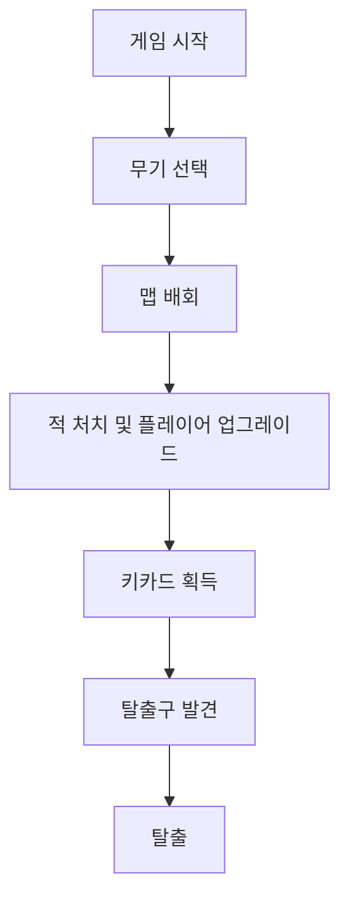

---
aliases:
작성 날짜: 2026-11-03T01:17
작성자:
관여 주체:
categories:
  - "[[미분류 문서]]"
노트 타입: "[[기획 문서]]"
---
# 개요

일단은 프로토타입에서 어디까지 구현할 것인지 판단을 위해, 프로토타입이 어떻게 작동해야 할지 고민해봐야겠다는 생각을 해보았다.

지금까지 구현된 것은 [[구현 기록]]에 저장할 생각이다. 게임이 제공하고자 하는 궁극적인 재미는 [[이 게임의 재미 요소]]에서 이미 선언해두었기에, 이 재미 요소를 시험해볼 수 있는 수준으로만 만들어볼 생각이다.

# 프로토타입 기준 플레이 루틴

# 각 단계에서 필요한 기획 요소들

1. 게임 시작
2. 무기 선택
	- [[프로토타입 플레이어용 무기에 필요한 것들|프로토타입에서 사용할 무기들]]
	- [[프로토타입 UI 기획 문서(구글 슬라이드)|프로토타입용 총기 선택 UI]]
3. 맵 배회
	- 기초 맵 제작 필요
	- 임시 테스트용 맵
4. 적 처치 및 플레이어 업그레이드
	- 실제 작동하는 적을 구현하기 위한 요소
	- 플레이어를 업그레이드하기 위한 수단
		- 아마도 총기 부품, 증강, 방어구 이런 것들
	- 플레이어가 본인을 업그레이드할 수 있는 수단을 보관하기 위한 인벤토리
	- 아이템 개념
5. 키카드 획득
	- 특수 아이템 - 키카드
6. 탈출구 발견
	- 탈출구 시스템
7. 탈출
	- 탈출 조건 명세
	- 탈출 후 UI