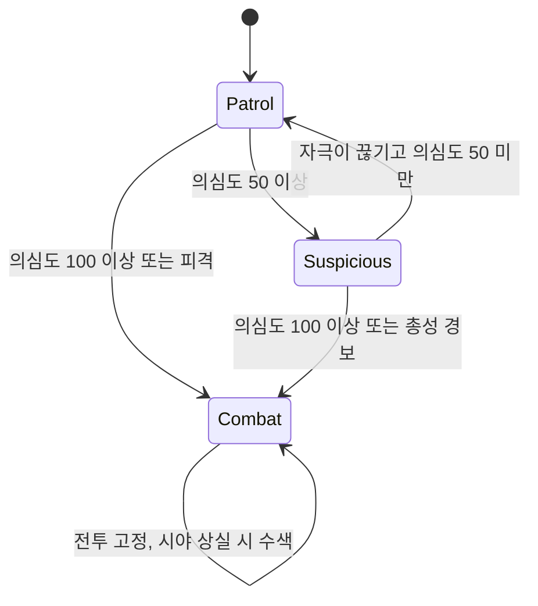
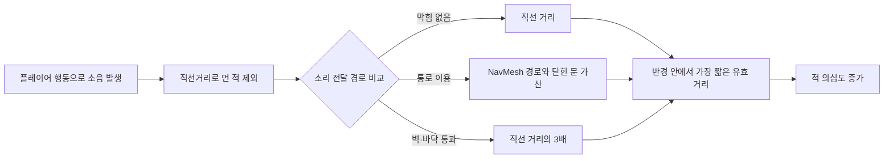

---
aliases:
작성 날짜: 2026-11-06
작성자:
  - "[[인공지능 에이전트]]"
관여 주체:
  - "[[적]]"
  - "[[플레이어 캐릭터]]"
categories:
  - "[[이현종 게임잼 프로토타입 구현 기록]]"
노트 타입: "[[기획 문서]]"
---

# 적 AI·소음 및 병원 잠입 구현 기록

## 구현 개요

`EnemyAI`가 한 적의 인식, 행동, 이동, 발사, 재장전, 애니메이션 연결과 사망 처리를 담당한다. `Noise`는 소리가 실제로 도달할 수 있는 거리를 계산해 적에게 자극을 전달한다. 병원에서 적 생성과 순찰 경로·임무 배치를 수행하는 에디터 도구는 `Assets/Scripts/Editor/AsylumEnemyPlacer.cs`다.

## 적 행동과 의심도

적의 기본 행동은 ^[Guard]와 ^[Patrol]로 나뉜다. ^[Guard]는 생성된 위치를 지키며 설정한 범위 안에서 좌우를 살핀다. ^[Patrol]은 인스펙터에서 지정한 지점을 순서대로 순환하고 각 지점에서 대기한다 (`Assets/Scripts/Enemies/EnemyAI.cs:23-29`, `:69-76`, `:577-609`). 이 기본 행동 위에 의심도 S로 관리되는 인식 상태가 추가된다. 기본적으로 의심도 50부터 ^[Suspicious], 100부터 ^[Combat]이며 ^[Combat]에 들어간 적은 자연 감소로 순찰 상태에 돌아오지 않는다 (`EnemyAI.cs:31-37`, `:78-84`, `:291-313`).

| 상태 | 진입 조건 | 기본 행동 |
| --- | --- | --- |
| 순찰 | 의심도 50 미만 | 경비 지점 유지 또는 지정 경로 순찰 |
| 경계 | 의심도 50 이상, 100 미만 | 소리 지점을 확인하고 천천히 접근 |
| 전투 | 의심도 100 이상 또는 피격·총성 경보 | 보이는 표적 사격, 안 보이면 마지막 위치 수색. 상태는 자연 감소하지 않음 |

시야 판정은 적의 눈 위치에서 플레이어 조준 지점으로 레이를 쏘고, 가장 먼저 맞은 대상이 플레이어인지 확인하는 방식이다. 중앙 시야의 전체 폭은 60도이며 플레이어를 보면 기본 초당 50 의심도를 얻는다. 중심에서 벗어난 좌우 20도씩의 주변 시야에서는 플레이어가 움직일 때 초당 15를 더한다. 다만 이미 ^[Combat] 상태인 적은 주변 시야에서 정지한 플레이어도 인식할 수 있다 (`EnemyAI.cs:86-96`, `:365-431`).

새로운 자극이 없고 플레이어도 보이지 않는 상태가 10초 이어지면, 전투에 진입하지 않은 적의 의심도는 초당 10씩 내려간다. 경계 상태의 적은 소리가 난 위치를 기본 1.5초 동안 바라본 뒤 `0.9 m/s`로 접근해 주변을 살핀다. ^[Combat] 상태에서 시야를 놓치면 마지막으로 인식한 위치로 달려가고, 도착 후 기본 반경 8m 안의 지점을 계속 확인한다. 달리기 속도는 기본 `3.5 m/s`다 (`EnemyAI.cs:98-108`, `:110-123`, `:306-313`, `:523-575`). 발견 직후 바로 쏘지 않도록 첫 사격 지연도 현재 상태별로 다르다. 순찰 중 발견은 4초, 경계 중 발견은 3초, 이미 전투 중인 상태에서 다시 발견하면 2초를 기다리며, 0.5초 이내의 짧은 시야 상실은 새 발견으로 취급하지 않는다 (`EnemyAI.cs:98-108`, `:399-423`).

## 이동, 발사와 적 종류

적의 이동 목적지는 ^[NavMesh]에 투영해 경로를 구하고, 경로 코너를 따라간다. 유효 경로를 얻지 못하면 목표까지 직선으로 이동하는 대체 처리를 한다. 경로는 0.5초마다 또는 목적지가 달라졌을 때 다시 계산하며, 이동 방향 앞의 닫힌 문은 적이 직접 연다 (`EnemyAI.cs:611-679`). 몸은 목표를 향해 돌려 세우고, 1.5초 이상 움직이려 해도 실제 이동이 막히면 경로를 갱신하거나 조사·수색 지점을 조정한다 (`EnemyAI.cs:508-521`).

적은 플레이어를 보고 있고, 사거리와 바라보는 방향이 맞으며, 이동이 거의 멈췄을 때 사격한다. 사격은 설정된 크기의 점사 단위로 이루어진다. ^[Patrol] 상태에서는 기본 탄퍼짐보다 정확도가 낮고 ^[Combat] 상태에서는 정확도가 높아진다. ^[Rifle], ^[Shotgun], ^[Pistol] 구분에 따라 무기 프리팹과 사격 설정을 연결하며, 발사 간격·점사 수·사거리·피해량·탄창 크기는 ^[EnemyAI] 컴포넌트의 설정값으로 관리한다 (`EnemyAI.cs:16-21`, `:50-61`, `:743-817`). 재장전 시 라이플과 권총은 일정 시간 뒤 탄창을 채우고, 샷건은 재장전 애니메이션 루프에 맞춰 탄을 한 발씩 채운다 (`EnemyAI.cs:833-864`).

플레이어에게 총격을 받은 적은 시야에 플레이어가 없어도 ^[Combat]에 진입하고, 가해자 위치를 마지막 확인 위치로 삼을 수 있다. 사망하면 머리 피격 여부를 기준으로 사망 애니메이션을 고르고, 상체 무기 자세를 페이드아웃한 뒤 손에 들고 있던 총을 물리 오브젝트로 분리한다. 시체와 총기는 설정된 수명 뒤 제거된다 (`EnemyAI.cs:348-357`, `:922-1022`). 몸통 피격 수와 헤드샷의 실제 피해 전달은 [[플레이어 이동·전투 및 탄환 구현 기록]]에 설명했다.

## 소음 발생과 전달

플레이어의 소음 자극은 ^[PlayerNoise]가 만든다. 이동 소음은 현재 ^[PlayerMovement.Gait]에 따라 매 프레임 발생하므로, 느린 걷기·걷기·달리기 프로필의 기본 반경은 각각 2m, 5m, 10m이고 의심도는 초당 5, 5, 10이다 (`Assets/Scripts/Player/PlayerNoise.cs:26-36`, `:57-69`, `:98-105`). 무기의 ^[Fired] 이벤트는 사격 소음을 발생시킨다. 소음기 사격은 기본 반경 10m와 의심도 30, 일반 사격은 반경 50m와 의심도 100이다. 재장전은 탄창이 가득 차 있지 않을 때만 반경 2m와 의심도 5를 만들고, 문 조작도 반경 2m와 의심도 5로 전달된다 (`PlayerNoise.cs:31-36`, `:72-96`).

| 플레이어 행동 | 소음 반경 | 의심도 | 발생 방식 |
| --- | ---: | ---: | --- |
| 느린 걷기 | 2 m | 초당 5 | 이동 중 누적 |
| 걷기 | 5 m | 초당 5 | 이동 중 누적 |
| 달리기 | 10 m | 초당 10 | 이동 중 누적 |
| 소음기 사격 | 10 m | 30 | 발사 시 1회 |
| 일반 사격 | 50 m | 100 | 발사 시 1회 |
| 재장전 | 2 m | 5 | 탄창이 가득 차지 않았을 때 |
| 문 조작 | 2 m | 5 | 상호작용 시 1회 |
| 장부 회수 | 12 m | 60 | 아이템별 추가 설정 |

^[Noise.TravelDistance]는 단순 반경 검사 대신 실제로 소리가 이동할 수 있는 경로를 비교한다. 먼저 직선거리를 이용해 멀리 있는 적을 빠르게 제외한다. 사이에 막힌 것이 없으면 직접 거리를 사용하고, 장애물이 있으면 ^[NavMesh] 경로 길이에 닫힌 문 하나당 3m를 더한 거리와 벽·바닥을 통과하는 거리(직선거리의 3배) 중 더 짧은 쪽을 소리 전달 거리로 본다 (`Assets/Scripts/Enemies/Noise.cs:9-20`, `:29-39`, `:60-86`).

적의 총성은 다른 적에게도 경보를 전달한다. 기본 경보 반경은 35m이며, 소리 이동 판정을 통과한 적은 ^[HearGunfire]를 통해 전투 상태가 되고 플레이어가 있는 방향으로 움직인다 (`EnemyAI.cs:127-135`, `:338-346`, `Noise.cs:42-57`). 따라서 총격은 한 명과의 교전에서 인근 적들이 합류하는 상황으로 번질 수 있다. 실제 발걸음 음향은 별도 ^[AudioSource]로 재생하며, 플레이어는 이동 거리마다 발걸음을 재생하고 느린 걷기·걷기·달리기에 따라 보폭 간격과 음량을 바꾼다 (`Assets/Scripts/Player/PlayerFootsteps.cs:11-19`, `:39-60`).

## 병원 레벨의 임무·적 배치

병원 씬의 편집 메뉴 `Tools/Game Jam/Build Asylum Level (Enemies + Mission)`은 `AsylumEnemyPlacer`를 실행한다. 도구는 기존 Enemies 루트를 제거하고 사전에 선언한 ^[Guard]·^[Patrol] 설정에 맞춰 적과 순찰 경로점을 만든다 (`Assets/Scripts/Editor/AsylumEnemyPlacer.cs:130-225`). 각 적 설정은 방 이름 또는 지정 좌표, 층 높이, 무기 종류, 시야 방향과 탐색 범위, 순찰 대기 시간으로 구성된다. 경비는 방 중심 또는 지정 지점 가까이에서 빈 바닥을 찾아 배치한다. 순찰 지점 사이에는 ^[NavMesh] 경로가 있는지 검사하고, NavMesh가 없는 경우에는 캡슐 검사로 이동 가능성을 확인한다 (`AsylumEnemyPlacer.cs:19-51`, `:149-212`, `:321-397`).

코드에 선언된 병원 배치는 ^[Guard] 9명과 ^[Patrol] 7명으로 구성된다. 주 경로를 지키는 적뿐 아니라 닫힌 방 안에 배치되는 증원 적도 포함한다 (`AsylumEnemyPlacer.cs:53-128`). 이는 생성 도구의 설정 수이며, 이 문서는 씬 생성 성공 여부나 실제 플레이 밸런스를 검증한 결과를 주장하지 않는다. 열쇠카드는 2층의 테이블 후보 6곳 중 한 곳을 ^[RandomSpot]으로 선택하게 하고, `Abandoned_Hospital/Keycard` 키로 런 중 선택 위치를 유지한다. 지하 장부는 반경 12m·의심도 60의 소리를 내며, 시체안치소 문은 keycard 아이템을 요구한다 (`AsylumEnemyPlacer.cs:227-269`). 병원 순찰 배치와 긴장 곡선은 `레벨디자인.md`에 별도로 설명되어 있으나, 그 문서의 노출 분석과 조정값도 본 기록에서 실제 플레이로 확인하지는 않았다.
