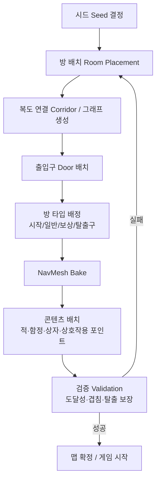

---
aliases:
작성 날짜: 2026-10-04T15:24
작성자:
  - "[[인공지능 에이전트]]"
관여 주체:
  - "[[맵]]"
categories:
  - "[[절차적 맵 생성 아이디어들]]"
노트 타입: "[[기획 문서]]"
---
> [!info] 이 문서의 목적
> [[절차적 맵 생성 아이디어들]]의 브레인스토밍([[절차적 맵 생성 브레인스토밍]])을 바탕으로, 실제 구현 관점에서 어떤 방식으로 만들면 좋을지 정리한 문서임. 결론을 먼저 말하면 **방-복도(Room-and-Corridor) 그래프 기반 생성**을 추천함.

## 0. 전제: 이 게임에 맞는 생성 목표

[[이 게임의 재미 요소]]에서 정의한 재미(탐험, 파밍/성장, 전략적 전투의 긴장감)를 절차적 맵이 직접적으로 뒷받침해야 함. 따라서 생성기는 단순히 "랜덤한 미로"가 아니라 아래 조건을 만족해야 함.

- **탐험**: 미지의 구역을 돌아다니는 구조 → 방과 복도가 많고, 지름길/우회로(루프)가 존재해야 함.
- **전략적 전투/은신**: [[소음 시스템]], [[암살 시스템]]이 성립하려면 엄폐물·시야 차단·우회 동선이 필요함.
- **파밍/성장**: [[보상 상자]]·보상 방이 적절한 위험 대비 보상 구조를 가져야 함.
- **탈출**: [[탈출구 패널]]로 이어지는 경로가 항상 보장되어야 함.

추가 제약:
- Unity `6000.3.24f1` 기준 ([[개발 환경 안내 문서]]).
- 적 AI가 쓰는 **NavMesh**를 생성 결과물에 맞춰 반드시 함께 만들어야 함.
- 방/복도 구조는 소음 전파([[소음 레벨]])와 암살 동선에 직접 영향을 주므로, 생성 단계에서 이를 고려해야 함.

## 1. 전체 생성 파이프라인

생성은 아래 순서를 따르는 것을 권장함. 각 단계는 **이전 단계의 결과만 입력으로 받는** 단방향 파이프라인으로 만들면 디버깅이 쉬움.



> [!important] 핵심 원칙
> **검증(Validation) 실패 시 재생성할 수 있는 루프**를 반드시 넣어야 함. 절차적 생성은 "만들고 나서 확인"이 아니라 "확인까지가 생성"임.

## 2. 알고리즘 비교

절차적 맵 생성에 널리 쓰이는 방식을 이 게임 기준으로 비교함.

| 알고리즘 | 방식 요약 | 장점 | 단점 | 이 게임 적합성 | 구현 난이도 |
| --- | --- | --- | --- | --- | --- |
| **BSP 트리** | 공간을 이분할해 방을 배치 | 구현 쉬움, 방이 겹치지 않음 | 복도가 단조롭고 루프가 적음 | 보통 (초기 프로토타입용) | 낮음 |
| **그래프 기반 (방 배치 + Delaunay/MST)** | 방을 흩뿌린 뒤 그래프로 연결 | 루프·우회로·방 타입 배정이 자유로움 | 구현 요소가 많음 | **매우 높음 (추천)** | 중간 |
| **WFC (Wave Function Collapse)** | 타일 제약 전파로 배치 | 결과물이 자연스럽고 다양함 | 학습/튜닝 난이도 높고 디버깅 어려움, NavMesh 연동 까다로움 | 보통~높음 | 높음 |
| **그리드 / 셀룰러 오토마타** | 격자 기반 지형 생성 | 지형(동굴 등) 표현에 강함 | 방·복도 같은 인공 구조 표현이 약함 | 낮음 | 낮음~중간 |
| **순수 랜덤 배치** | 방을 무작위로 배치 | 가장 단순 | 겹침/고립/도달 불가 다발 | 매우 낮음 | 매우 낮음 |

> [!important] 추천: 그래프 기반 방-복도 생성
> 이 게임은 "인공적인 시설(방·복도)" + "루프가 있는 탐험 구조" + "방 단위 콘텐츠 배치"가 모두 필요하므로 **그래프 기반**이 가장 잘 맞음. BSP로 시작해 그래프 기반으로 확장하는 로드맵도 좋음(11장 참조).

### 그래프 기반 생성 절차 (권장안)

1. **방 배치**: Poisson Disk Sampling 또는 BSP로 방을 겹치지 않게 흩뿌림.
2. **그래프 연결**: 방 중심점들로 Delaunay 삼각분할 → 최소 신장 트리(MST)로 필수 연결 → 남은 엣지 일부를 무작위로 추가해 **루프** 생성.
3. **복도 생성**: 엣지마다 두 방을 잇는 복도를 그림(L자/직선).
4. **출입구**: 복도가 방과 만나는 지점에 문 배치.

```csharp
// 개념 예시 (의사코드)
var rooms = PlaceRooms(seed, count);
var graph = BuildDelaunay(rooms);
var mst = BuildMST(graph);                 // 모든 방 연결 보장
foreach (var edge in graph.Edges.Except(mst.Edges))
    if (Rng(seed).NextFloat() < loopChance)
        mst.AddEdge(edge);                 // 루프/지름길 추가
BuildCorridors(mst);
```

## 3. 데이터 구조

생성 결과를 "그래프 + 방" 구조로 명확히 표현하는 것이 중요함. 방 타입은 아래처럼 열거형으로 관리.

```csharp
enum RoomType { Start, Normal, Reward, Exit }

class Room {
    public int Id;
    public RoomType Type;
    public RectInt Bounds;
    public List<Door> Doors;
    public List<Vector2Int> PropAnchors; // 엄폐물·상자 배치 후보 지점
}

class MapGraph {
    public List<Room> Rooms;
    public List<(int from, int to)> Corridors; // 엣지 = 복도
}
```

- **방 템플릿**: 방 종류별 프리팹/레이아웃을 `ScriptableObject`로 정의해두고, 생성 시 템플릿을 골라 채우는 방식이 유지보수에 유리함.
- **엄폐물(장애물)**: 자유 배치보다 **방 템플릿에 미리 정의된 앵커 지점**에 배치하는 편이 밸런스와 시야 확보에 안전함.

## 4. 지형 생성 상세

### 4-1. 방 배치
- 최소 간격을 두고 배치(겹침 방지). 방 크기는 최소/최대 범위 내 무작위.
- 이 게임은 은신이 중요하므로 **작은 방과 큰 방을 섞어** 시야/엄폐의 리듬을 만드는 것을 권장.

### 4-2. 복도 연결
- MST로 **고립된 방이 없도록** 보장.
- 추가 엣지로 **루프를 확보**. 루프는 "적을 피해 우회하는 동선"을 제공해 [[암살 시스템]]·은신 플레이와 잘 맞음.
- 복도 폭/길이를 다양화하면 소음 전파([[소음 레벨]]) 차이가 생겨 전략성이 올라감.

### 4-3. 출입구(문)
- 복도와 방의 접점에 문을 배치. 문은 시야·소음 차단 요소로 활용 가능.

### 4-4. 방 타입 배정
그래프의 **시작 방으로부터의 거리**를 기준으로 배정하면 위험-보상 구조가 자연스럽게 형성됨.

| 타입 | 배정 규칙 |
| --- | --- |
| 시작 방 | 그래프 중심 또는 고정 지점 |
| 일반 방 | 나머지 대부분 |
| 보상 방 | 막다른 길(degree 1) 또는 시작에서 먼 분기 끝 |
| 탈출구 | 시작 방에서 **그래프 최장 거리** 노드 |

> [!tip] 탈출구는 복수 배치도 고려
> [[탈출구 패널]]을 하나만 두면 동선이 단조로워질 수 있음. 서로 다른 방향의 2~3개 중 하나를 활성화하는 방식이면 탐험과 재방문을 유도할 수 있음.

## 5. 게임플레이 요소 배치

[[절차적 맵 생성 브레인스토밍]]에서 나온 요소들을 생성 파이프라인 어디에 넣을지 정리.

| 요소 | 배치 시점 | 배치 규칙 |
| --- | --- | --- |
| 적 생성 위치 | 콘텐츠 배치 | 시작 방 제외, 시작으로부터의 거리에 비례해 밀도 증가 |
| 적 순찰 경로 | 콘텐츠 배치 | NavMesh 위 waypoint 루프 자동 생성 |
| [[함정]] (클레이모어) | 콘텐츠 배치 | 복도/방 입구, **탈출 필수 경로는 차단하지 않도록** |
| [[보상 상자]] | 콘텐츠 배치 | 보상 방·막다른 길에 우선 배치 |
| [[상호작용 포인트]] | 콘텐츠 배치 | 상자·시체·패널 등 상호작용 대상마다 1개 |
| [[탈출구 패널]] | 방 타입 배정 단계 | 탈출구 방에 배치 |

### 5-1. 적 순찰 경로 자동 생성
- 방/복도 그래프를 그대로 활용해 **인접 노드를 잇는 루프 경로**를 만들면 자연스러운 순찰이 됨.
- NavMesh 위에서 `NavMesh.CalculatePath`로 실제 경로를 검증한 뒤 waypoint로 저장.

### 5-2. 함정 배치 주의점
- [[범위형 데미지]]를 가진 함정은 **스폰 지점·탈출 경로와 겹치지 않게** 배치.
- 배치 후 "함정 제거 시에도 탈출 가능한가"를 검증에 포함.

## 6. 검증 (Validation)

생성 직후 아래를 자동 검사하고, 실패하면 재생성.

- **도달성**: 시작 방 → 모든 방 → 탈출구까지 BFS/Flood fill로 연결 확인.
- **NavMesh**: 모든 방·복도에 NavMesh가 베이크되었는지, 스폰 지점이 NavMesh 위에 있는지 확인.
- **탈출 보장**: 함정·적 배치 후에도 탈출 경로가 존재하는지 재확인.
- **겹침 방지**: 적·상자·함정 스폰 지점 간 최소 거리 확보.
- **고립 방**: degree 0인 방이 없는지 확인.

> [!important]
> 검증은 **게임플레이 규칙 기반**으로 작성해야 함. "예쁘게 보이는가"가 아니라 "플레이가 성립하는가"를 검사하는 것.

## 7. 소음·은신 시스템 연동

이 게임만의 특징이라 생성 단계에서 특히 신경 써야 함.

- **소음 전파**: 방/복도가 열린 구조면 [[소음 레벨]]이 넓게 퍼짐. 벽·문으로 구획된 구조가 은신 플레이를 살림.
- **암살 동선**: [[암살 시스템]]은 적 뒤에서 접근해야 하므로, **엄폐물과 우회 루프**가 충분해야 함. 루프가 없는 직선 맵은 은신이 불가능에 가까움.
- **시야 차단**: 큰 방에는 엄폐물을, 복도에는 굴곡을 두어 시야를 끊는 것을 권장.

## 8. 난이도 스케일링

- 시작 방에서의 **그래프 거리**를 난이도 축으로 사용.
- 거리가 멀수록: 적 밀도 ↑, 함정 ↑, 보상 품질 ↑.
- 층/스테이지 개념이 생기면 파라미터(방 수, 적 수, 함정 수)를 단계별로 조정.

## 9. 재현성·디버깅

- **시드 고정**: 모든 무작위 요소는 하나의 시드에서 파생. 같은 시드 → 같은 맵.
- **시각화**: 방 그래프·복도·배치 지점을 `Gizmos`로 그려 확인.
- **단계별 덤프**: 각 단계 결과를 로그/이미지로 남기면 어느 단계에서 문제가 생겼는지 추적 가능.

## 10. Unity 구현 고려사항

| 항목 | 자체 구현 | 에셋 사용 |
| --- | --- | --- |
| 장점 | 완전한 제어, 프로젝트 특화 | 빠른 프로토타이핑 |
| 단점 | 개발 시간 | 커스터마이징 제약, 비용 |
| 예시 | 위 그래프 알고리즘 직접 구현 | Dungeon Architect, Edgar, MapMagic 등 |

- 이 게임은 **소음·은신·탈출**이라는 특수 요구가 있어 완전한 범용 에셋보다 **자체 구현 + 모듈러 방 프리팹** 조합을 추천.
- 방 프리팹은 **모듈러 킷**으로 만들어 조합 가능하게 하면 재사용성이 높음.
- 생성 시점은 **런타임 생성**을 기본으로 하되, 개발 중에는 **에디터 생성**으로 빠르게 확인.

## 11. 단계별 로드맵

> [!tip] MVP부터
> 처음부터 그래프 기반 전체를 만들려 하지 말고 단계적으로 확장할 것.

1. **1단계 (프로토타입)**: BSP로 방·복도 생성 + 시작/탈출 배정 + 도달성 검증.
2. **2단계**: 그래프 기반으로 전환, 루프 추가, 방 타입(보상) 배정.
3. **3단계**: NavMesh 연동, 적 스폰·순찰 경로 자동 생성.
4. **4단계**: 함정·상자·상호작용 포인트 배치 + 소음/은신 고려 튜닝.
5. **5단계**: 난이도 스케일링, 시드 재현성, 디버그 시각화 정리.

## 참고 문서

- [[절차적 맵 생성 브레인스토밍]]
- [[이 게임의 재미 요소]]
- [[소음 시스템]], [[소음 레벨]]
- [[암살 시스템]]
- [[상호작용]], [[상호작용 포인트]]
- [[개발 환경 안내 문서]]
