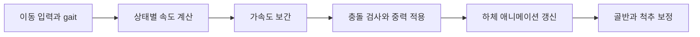
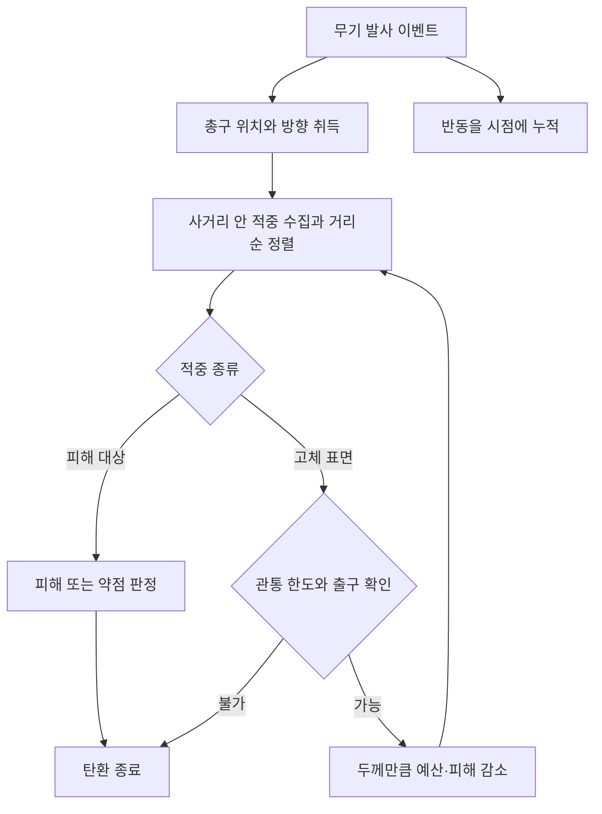

---
aliases:
작성 날짜: 2026-11-06
작성자:
  - "[[인공지능 에이전트]]"
관여 주체:
  - "[[플레이어 캐릭터]]"
  - "[[무기]]"
  - "[[적]]"
categories:
  - "[[이현종 게임잼 프로토타입 구현 기록]]"
노트 타입: "[[기획 문서]]"
---

# 플레이어 이동·전투 및 탄환 구현 기록

## 한눈에 보기

KINEMATION이 제공하는 플레이어와 무기 동작에 프로젝트 이동·소음·피해 시스템을 연결했다. 플레이어 이동은 CharacterController를 사용하고, 발사는 총구에서 시작하는 레이캐스트와 관통 처리로 판정한다. 아래 표와 흐름도는 이동 속도, 피격 결과, 발사 처리의 핵심만 요약한다.

## 구현 개요

프로토타입은 KINEMATION Tactical Shooter Pack의 플레이어·무기·애니메이션을 바탕으로 한다. 프로젝트 스크립트는 `CharacterController` 이동, 소음과 발걸음, 시점 입력 보정, 실제 피해 판정과 반동을 보탠다. 대표 진입점은 `Assets/Scripts/Player/PlayerMovement.cs:16-19`, `Assets/Scripts/Player/MouseLook.cs:10-13`, `Assets/Scripts/Weapons/PlayerGunplay.cs:54-56`이다.

## 이동과 애니메이션

`PlayerMovement`는 KINEMATION의 ^[TacticalProceduralAnimation.moveInput]을 받아 실제 이동을 계산한다. 입력 벡터의 크기를 1로 제한한 뒤 플레이어의 우측과 전방 방향을 기준으로 속도를 만들고, ^[CharacterController.Move]로 이동과 중력을 적용한다 (`PlayerMovement.cs:173-191`).

느린 걷기, 걷기, 달리기의 기본 속도는 각각 `0.9 m/s`, `1.8 m/s`, `4.8 m/s`다. Ctrl을 누르고 있는 동안에는 느린 걷기를 우선하며, 그 외에는 KINEMATION 애니메이터의 gait 값을 이용해 걷기와 달리기 속도를 보간한다. 수평 가속도도 별도 보간으로 적용한다 (`PlayerMovement.cs:21-26`, `:74-78`, `:177-191`). 이 스크립트에서는 점프 입력을 확인할 수 없다.

| 이동 상태 | 입력 또는 조건 | 기본 속도 |
| --- | --- | ---: |
| 느린 걷기 | Ctrl 홀드 | 0.9 m/s |
| 걷기 | 기본 이동 | 1.8 m/s |
| 달리기 | KINEMATION gait 값이 달리기 상태 | 4.8 m/s |

시점의 yaw 입력은 상체만 비트는 값으로 남겨 두지 않고 플레이어 몸체 회전에 옮긴다. 하체 애니메이션은 ^[LowerBody] 레이어에 적용하며, 이동 속도에 따라 걷기 클립 재생률을 조절한다. 후진할 때는 클립을 역재생하고, 옆걸음에서는 다리 방향을 최대 60도까지 회전시킨다 (`PlayerMovement.cs:122-149`, `:162-171`). 걷기 클립의 고정된 골반 높이로 인해 발이 뜨거나 바닥에 묻히는 현상은 가장 낮은 발에 맞춰 골반을 보정하는 방식으로 줄인다. 동시에 척추를 반대 방향으로 움직여 상체와 머리에 붙은 카메라가 함께 흔들리지 않게 한다 (`PlayerMovement.cs:106-120`).

## 마우스 시점

`MouseLook`은 Input System의 ^[Look] 액션을 프레임마다 읽어 누적 마우스 델타를 ^[TacticalShooterPlayer.ApplyLook]에 전달한다. 실행 순서를 `-60`으로 지정해 `PlayerMovement`가 몸체 회전을 계산하기 전에 시점 입력을 반영한다 (`MouseLook.cs:10-13`, `:29-52`). 기본 스무딩은 `0.02초`이며, 프레임마다 들어온 입력을 여러 프레임에 나누어 적용하되 입력량 자체는 버리지 않는다.

감도는 전역 설정 ^[GameSettings.Sensitivity]를 바탕으로 하며, 조준 애니메이션 가중치가 높아질수록 조준 감도로 부드럽게 전환한다. 조준경 사용 중에는 활성 조준경 배율에 대한 추가 보정도 적용한다. 활성 조준경이 없거나 별도 조준 카메라 상태인 경우에는 배율을 1로 취급한다 (`MouseLook.cs:49-60`).

## 무기 발사와 반동

`PlayerGunplay`는 실행 순서를 `100`으로 두어 KINEMATION 플레이어가 무기를 생성한 다음 초기화된다. 인스펙터의 무기 프리팹 설정을 씬에 생성된 무기 인스턴스와 대응시키고, 무기의 발사 이벤트를 구독한다 (`PlayerGunplay.cs:54-91`). 발사되면 총구 위치와 방향을 가져와 `BulletTrace`로 판정을 넘긴다.

무기별 피해량, 사거리, 충격력, 관통 두께와 관통 횟수, 관통 뒤 피해 유지율은 인스펙터의 무기별 설정에 둔다 (`PlayerGunplay.cs:38-52`, `:101-118`). 반동은 연속 사격 횟수에 따라 커지는 수직 킥과 무기별 랜덤 범위·편향을 적용하는 수평 킥으로 구성된다.

발사 간격이 설정한 초기화 시간보다 길면 연속 사격 횟수를 처음부터 다시 세지만, 이는 시점을 원위치로 돌리는 동작은 아니다. 조준 중에는 조준 가중치에 따라 반동을 줄이고, 최종 반동을 실제 시점 입력에 더한다. 그 결과 플레이어가 마우스로 반동을 직접 보정해야 한다 (`PlayerGunplay.cs:11-36`, `:120-145`).

여기서 설명한 피해 판정과 시점 반동은 저장소의 프로젝트 코드에 한정된다. 무기 애니메이션과 일부 조작은 외부 KINEMATION 패키지 및 원본 수정 상태에 의존한다.

## 탄환 레이캐스트와 관통

`BulletTrace`는 ^[RaycastNonAlloc]으로 사거리 안의 적중을 모으고 가까운 순서대로 정렬한다. 정해진 크기의 버퍼가 가득 차면 적중 결과가 잘렸을 수 있으므로, 가까운 벽을 놓쳤다고 판단해 관통하는 일을 피하기 위해 단일 레이캐스트로 전환하고 관통을 비활성화한다 (`Assets/Scripts/Weapons/BulletTrace.cs:17-30`). 발사자 자신의 자식 콜라이더는 건너뛰며, 적중한 대상의 부모에서 ^[IDamageable]을 찾아 피해를 준다. ^[Rigidbody]에는 적중 위치에서 충격력을 적용하고, 설정된 피격 이펙트는 생성 후 5초 뒤 제거한다 (`BulletTrace.cs:35-50`).

탄환은 관통 두께 예산과 최대 관통 횟수가 남아 있을 때만 다음 적중으로 진행한다. 또한 처음 맞은 것과 같은 콜라이더 안에서 한도 내의 출구를 찾아야 한다. 출구가 없거나 두께가 설정 한도를 넘으면 탄환은 멈춘다. ^[IDamageable] 대상은 피해 적용 후 즉시 발사를 끝내므로, 관통 대상은 월드 지형·문과 같은 고체 표면이다. 표면 두께만큼 예산을 줄이고 다음 대상의 피해 배율도 낮춘다 (`BulletTrace.cs:52-76`). 문에 맞으면 진입점과 관통 출구에 ^[BulletImpactMarks]를 요청하며, 무기의 관통 깊이를 0으로 설정하면 고체 관통은 일어나지 않는다 (`PlayerGunplay.cs:45-48`, `BulletTrace.cs:52-60`).

## 체력, 헤드샷과 사망

`Health`는 최대 체력과 ^[hitsToKill]을 제공한다. ^[hitsToKill]이 양수면 무기별 피해 수치 대신 최대 체력을 설정한 횟수로 나눈 동일한 양을 적용하므로, 몸통을 몇 번 맞아야 쓰러지는지를 통일할 수 있다. 피해와 사망은 이벤트로 외부 시스템에 알린다 (`Assets/Scripts/Combat/Health.cs:7-19`, `:26-56`). `HitZone`은 부모 오브젝트에서 소유자의 `Health`를 찾아 피해를 전달한다. ^[instantKill]이 켜진 경우 정상 배율의 헤드샷은 즉사시키며, 관통으로 피해 배율이 낮아진 헤드샷은 배율에 비례한 피해를 적용한다 (`Assets/Scripts/Combat/HitZone.cs:7-27`).

| 피격 경로 | 적용 방식 | 결과 |
| --- | --- | --- |
| 몸통 | `hitsToKill`이 설정되면 최대 체력을 지정 횟수로 분할 | 반복 피격 후 사망 |
| 헤드샷 | `instantKill`이 켜지고 피해 배율이 정상인 경우 | 즉사 |
| 관통 헤드샷 | 관통 피해 배율을 유지해 약점 피해 적용 | 배율에 비례한 피해 |

플레이어가 사망하면 `PlayerDeath`가 현재 무기의 발사를 중단시키고 플레이어 입력과 이동을 비활성화한다. 이후 체크포인트 재시작 콜백이 연결된 결과 화면을 표시한다 (`Assets/Scripts/Combat/PlayerDeath.cs:27-42`). 적의 헤드샷 판정과 사망 애니메이션, 시체·무기 처리는 [[적 AI·소음 및 병원 잠입 구현 기록]]에 정리했다.

## 부착물 입력과 조준 장치

`PlayerLaser`는 ^[ToggleLaser] 입력을 받으면 현재 주무기의 언더배럴 부착물이 ^[FlashlightAttachment]인지 확인한다. 부착물에 ^[LaserSight]가 아직 없으면 런타임에 추가한 뒤 켜고 끈다 (`Assets/Scripts/Weapons/PlayerLaser.cs:17-35`). 이 프로젝트 코드가 직접 처리하는 것은 레이저 토글이며, 라이트 토글은 KINEMATION 부착물 기능을 이용한다. 따라서 실제 프리팹과 부착물 동작은 외부 에셋 및 원본 수정 상태에 의존한다.

맵 제작 공통 도구는 플레이어에 ^[PlayerNoise], ^[PlayerLaser], ^[PlayerInventory], ^[PlayerInteractor], ^[MouseLook], ^[PlayerFootsteps]가 있도록 확인하고 누락된 컴포넌트를 추가한다 (`Assets/Scripts/Editor/LevelBuildUtility.cs:12-21`).
