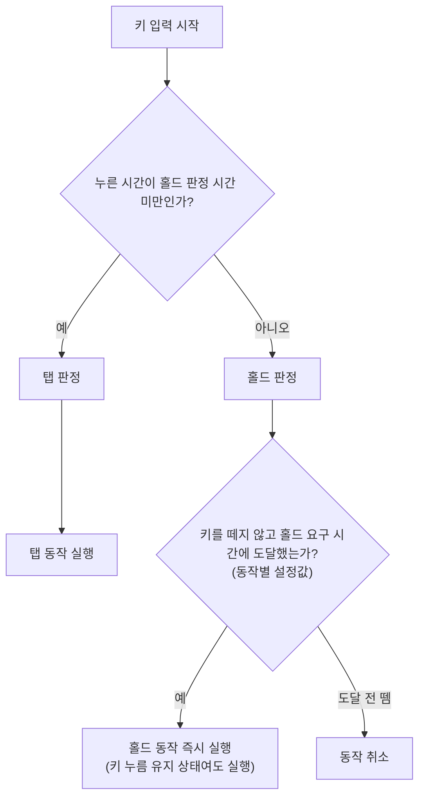

---
aliases:
작성 날짜: 2026-10-06T02:19
작성자:
  - "[[이준호]]"
관여 주체:
  - "[[유저]]"
categories:
  - "[[조작(초기 기획)]]"
tags:
  - 문서
---
[[유저]]가 키를 누르고 있던 시간이 [[홀드 판정 시간]] **미만**이면 [[탭]], **이상**이면 [[홀드]]로 판정한다. [[홀드]]로 판정되면 키를 **떼지 않은 채로** [[홀드 요구 시간]]에 도달하는 **즉시** 동작이 실행되며, 이 시간은 동작별로 설정 가능하다. 도달 전에 키를 떼면 [[탭]], [[홀드]] 어느 동작도 실행되지 않는다.

